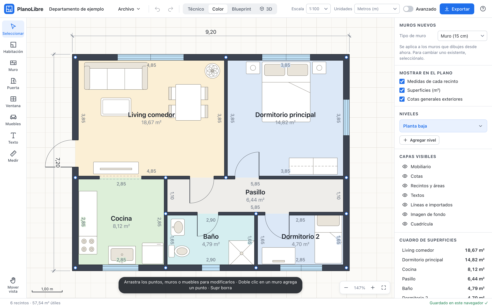
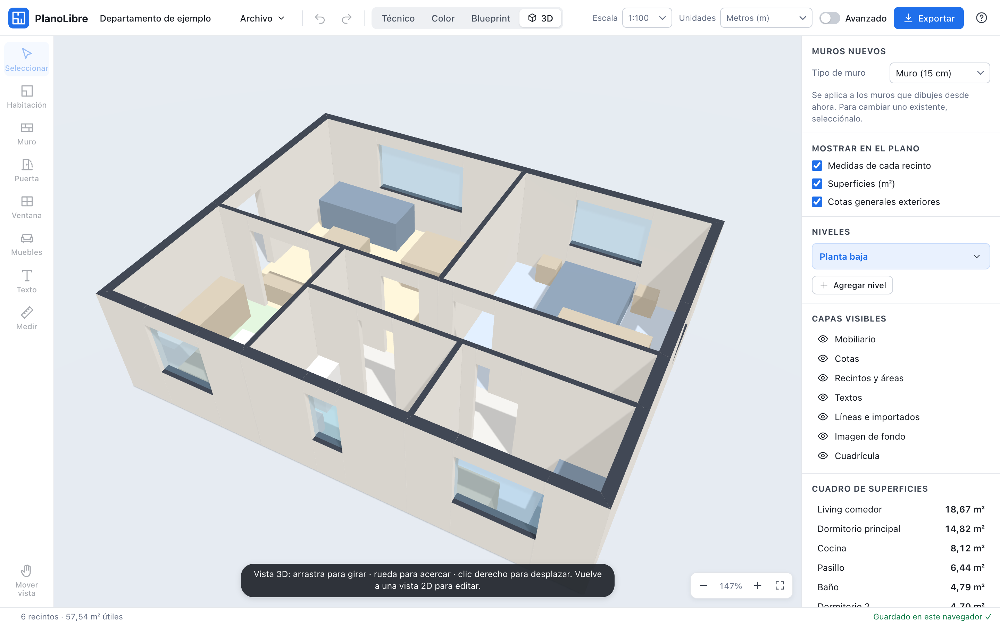
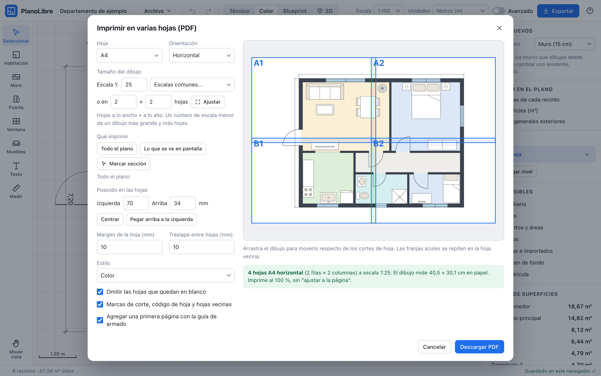
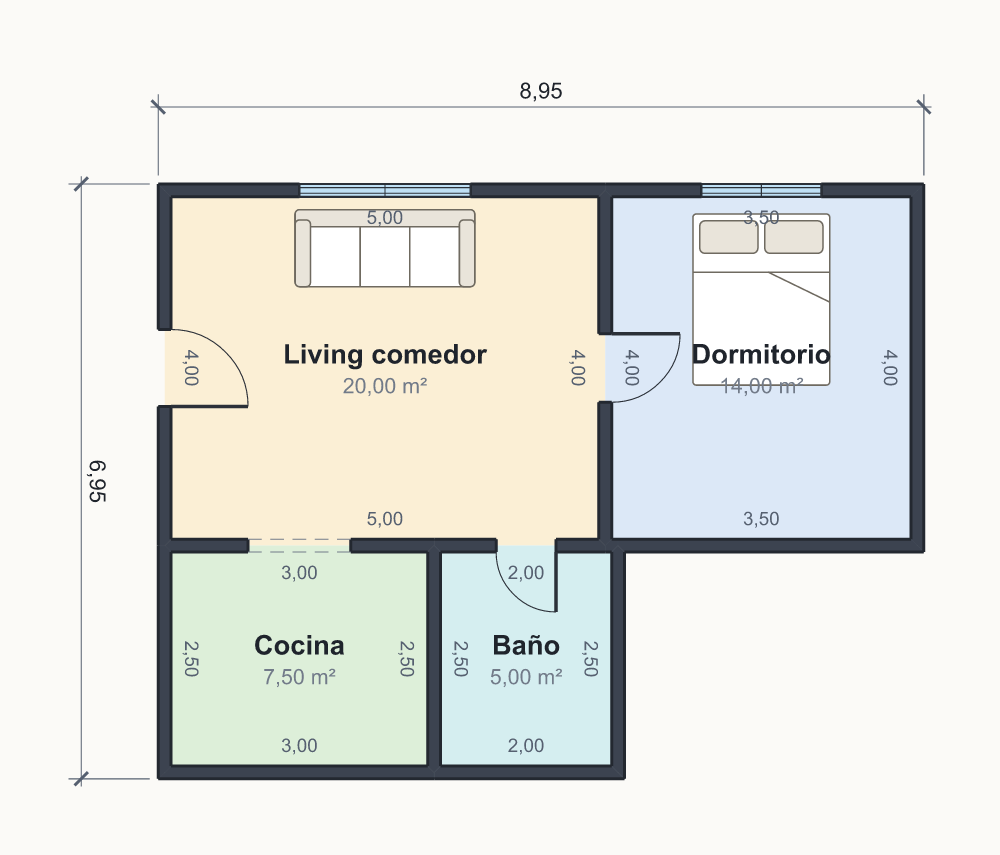

# PlanoLibre

*[Leer en español](README.md)*

An open-source floor plan editor that runs **entirely in your browser**. No account, no cloud, nothing to install.

**[Try it online](https://alexandermercado.github.io/planolibre/)**



> **The interface is in Spanish only.** The app is usable without reading much (the tools are icons and you draw by dragging), and there is a small glossary below. This page is a summary; the [Spanish README](README.md) is the full reference.

It is built for two kinds of people at once:

- **No experience:** drag a rectangle and you get a room with its dimensions and area. Drag a corner and everything is recalculated instantly.
- **Experienced:** turn on **Avanzado** (advanced mode) for manual dimensions, free lines, exact coordinates, layers, wall heights, precision settings and CAD export.

## Try it online

**https://alexandermercado.github.io/planolibre/**

Your plans are saved in your own browser; nothing is sent to a server.

## Run it locally

You need [Node.js](https://nodejs.org) 20 or newer.

```bash
npm install
npm run dev
```

Then open the address shown in the terminal (by default `http://localhost:5199`).

To produce a static build you can copy to any web server:

```bash
npm run build
```

The `dist/` folder is ready to publish as is.

## What it does

- **Walls and rooms.** Walls have real thickness, join at corners, split where they cross, and enclosed areas become rooms automatically. Interior dimensions and usable area update live as you drag points.
- **Doors, windows and furniture.** Hinged, double and sliding doors; sliding, casement and fixed windows; 42 parametric furniture symbols that snap against walls.
- **Annotations.** Text, manual dimensions, free lines and a measuring tool. Units in metres, centimetres, millimetres or feet and inches; scales from 1:10 to 1:1000.
- **Views.** Technical (black and white), colour (rooms tinted by use), blueprint, and a navigable 3D view.
- **Levels.** Several floors, with the one below shown in grey as a reference.
- **Saving.** Autosave in the browser, plus a readable `.plano` project file (JSON) you can back up, share or put under version control.



## File formats

| Format | Export | Import |
| --- | --- | --- |
| **PDF** | Yes: vector, to scale, on one sheet or tiled across several | Yes: as editable walls or as a tracing background |
| **DXF** | Yes (R12, with layers) | Yes: as editable walls, as a tracing reference, or view-only |
| **DWG** | **No** | Yes, same options as DXF |
| **Image** (PNG, JPG, WebP) | PNG | Yes: as a tracing background, with experimental wall recognition |
| **SVG** | Yes | — |

**DWG cannot be written.** It is a closed Autodesk format and there is no reliable free writer that runs in the browser. Export DXF and use "Save as DWG" in AutoCAD or the free ODA File Converter. DWG files are read with [LibreDWG](https://www.gnu.org/software/libredwg/) compiled to WebAssembly.

### Importing: editable walls, tracing, or view-only

When you open a DXF, DWG, PDF or image you choose how to load it:

- **Editable walls** (*Muros editables*): the app recognises walls (two parallel lines, or a solid filled stroke), closes the corners, detects doors and windows, and names rooms when the drawing contains labels. The result is a normal plan you can edit.
- **Tracing only** (*Sólo calco*): the drawing stays as a reference to draw over. The cursor snaps to the centre line of the drawn walls, so what you trace matches exactly.
- **View and print only** (*Sólo ver e imprimir*, DXF and DWG): opens the drawing as is, with only pan and measure tools and per-layer visibility.

How well wall recognition works depends on the source:

| Source | Result |
| --- | --- |
| DXF / DWG | The most reliable, especially when the drawing has a walls layer. Without layers, furniture drawn with parallel lines can be mistaken for walls. |
| Vector PDF (exported from a drawing program) | Good. |
| Scanned PDF or image | **Experimental.** Works on clean, straight plans with clearly drawn horizontal and vertical walls. Skewed photos do not work; use tracing instead. |

Always review the result. A single Ctrl+Z undoes the whole conversion.

### Printing large plans across several sheets

*Exportar → PDF en varias hojas* tiles the plan, at the scale you choose, across several A4, Letter or A3 sheets that you then join:

- Pick an exact scale, or ask for it to fit in N × M sheets.
- Print the whole plan, what is on screen, or a section you mark in the preview.
- Drag the drawing in the preview to control where the page cuts fall.
- Each sheet carries its code (A1, A2, B1…), crop marks and the code of its neighbours. The first page is an assembly guide.

Print at 100 %, without "fit to page", or the scale will be wrong.



## For agents and scripts: CLI and MCP server

The repository also ships a command line tool and an [MCP](https://modelcontextprotocol.io) server, so an agent (Claude or any MCP client) can draw, check and export floor plans without opening the browser. They share the app's code, so a plan made by an agent opens and stays editable in PlanoLibre. Use it from a clone; once the package is published to npm as `planolibre`, replace `node bin/planolibre.mjs` with `npx planolibre`.

```bash
git clone https://github.com/AlexanderMercado/planolibre.git
cd planolibre
npm install        # also builds bin/planolibre.mjs
node bin/planolibre.mjs convertir house.dxf house.pdf --escala 50 --papel A3
node bin/planolibre.mjs info house.plano
```

MCP client configuration. The server only reads and writes inside the folder you pass:

```json
{
  "mcpServers": {
    "planolibre": {
      "command": "node",
      "args": ["/path/to/planolibre/bin/planolibre.mjs", "mcp", "--carpeta", "/path/to/my-plans"]
    }
  }
}
```

Tool names, parameters and descriptions are in Spanish (`crear_plano`, `agregar_habitacion`, `agregar_abertura`, `resumen`, `vista_previa`, `importar`, `exportar`…). Every tool that changes the plan returns an updated summary with areas and warnings, so the agent can correct itself. Measurements are in metres, X to the right and Y downwards. See the [Spanish README](README.md#para-agentes-y-scripts-línea-de-comandos-y-mcp) for the full tool list.



## Interface glossary

| Spanish | English |
| --- | --- |
| Seleccionar · Habitación · Muro | Select · Room · Wall |
| Puerta · Ventana · Vano | Door · Window · Opening (no door) |
| Muebles · Texto · Medir | Furniture · Text · Measure |
| Cota · Línea · Mover vista | Dimension · Line · Pan |
| Archivo · Exportar · Avanzado | File · Export · Advanced |
| Técnico · Color · Blueprint · 3D | View modes |
| Recinto · Superficie · Nivel | Room · Area · Level (floor) |

Keyboard shortcuts follow the Spanish names: `V` select, `M` wall, `H` room, `P` door, `N` window, `T` text, `D` measure, `F` fit to screen, `Space` + drag to pan, `Ctrl+Z` / `Ctrl+Y` undo and redo.

## Known limitations

- The interface is in Spanish only.
- DWG export is not possible (see above).
- Walls are straight; there are no curved walls.
- It is a floor plan editor: no roofs, sections or elevations.
- DXF is exported without hatches; walls are outlines on the `MUROS` layer.
- Wall recognition only understands straight walls. On images it only handles horizontal and vertical ones and does not read text (there is no OCR).
- DWG import uses the same path as DXF but has been tested far less with real-world files.
- Furniture in an imported drawing is kept as reference lines, not converted to library symbols.
- Below 860 px wide the properties panel is hidden; the app is meant for desktop or tablet.

## How it is built

TypeScript with no framework, Vite, and a custom `<canvas>` renderer.

```
src/
  core/     Model and geometry, with no browser dependencies
            (wall topology, room detection, wall recognition)
  editor/   Interactive canvas: camera, snapping, selection and tools
  io/       PDF, DXF, DWG, images, SVG and local storage
  ui/       Top bar, panels and dialogs
  view3d.ts 3D view (three.js)
tests/      Geometry, DXF, PDF, project and wall recognition tests
```

One scene builder turns a level into a single list of drawing primitives that feeds the screen, PDF, SVG, PNG and DXF, so what you see is what you export. Heavy libraries (jsPDF, pdf.js, three.js and the 8 MB LibreDWG module) are loaded only when needed.

```bash
npm test          # automated tests
npm run typecheck
```

Code comments and identifiers are mostly in Spanish. Contributions are welcome in either language.

## License

GPL-3.0-or-later. The app bundles [LibreDWG](https://www.gnu.org/software/libredwg/) (through `@mlightcad/libredwg-web`) to read DWG files, which is GPL-3.0, so the whole is distributed under that license. See [LICENSE](LICENSE).
