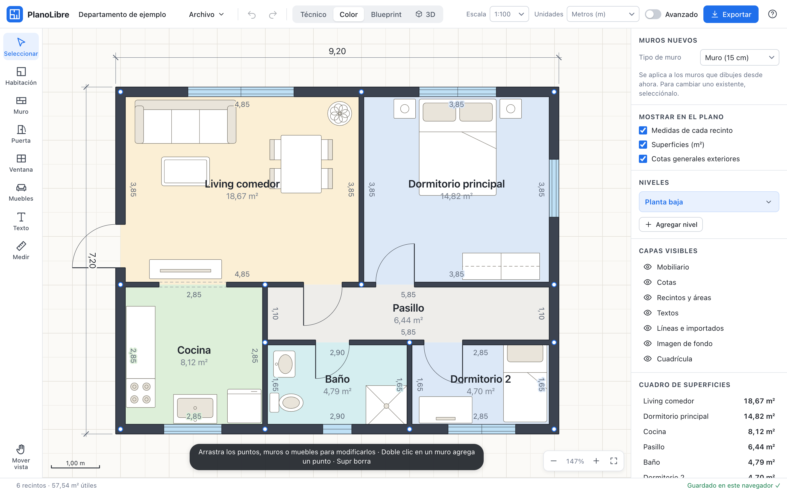
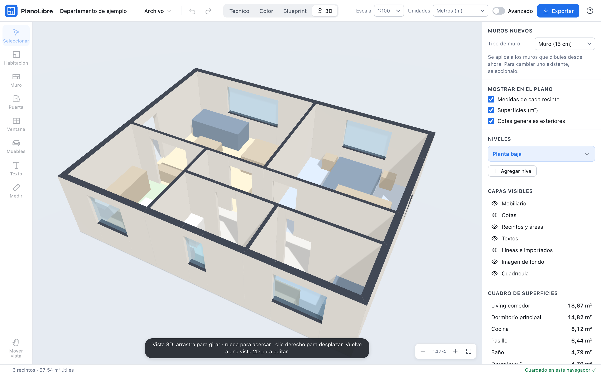
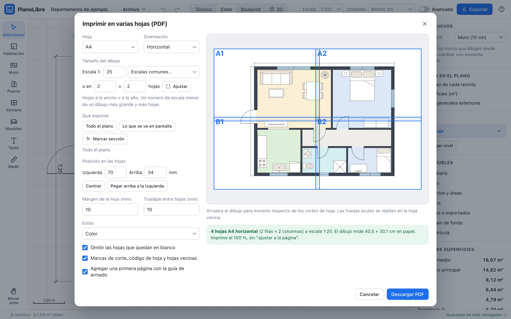

# PlanoLibre

*[Read this in English](README.en.md)*

Editor de planos de código abierto que funciona **100 % en tu computador**, dentro del navegador. Sin cuentas, sin nube, sin instalación pesada.

**[Probarlo en línea](https://alexandermercado.github.io/planolibre/)** — no hay que instalar nada.



Está pensado para dos tipos de persona a la vez:

- **Sin experiencia:** arrastras un rectángulo y tienes una habitación con sus medidas y su superficie. Arrastras un punto y todo se recalcula al instante.
- **Con experiencia:** activas el modo **Avanzado** y aparecen cotas manuales, líneas libres, coordenadas exactas, capas, alturas, ajustes de precisión y exportación a CAD.

## Usarlo en línea

No hay que instalar nada: **https://alexandermercado.github.io/planolibre/**

Funciona igual que en tu computador: los planos se guardan en tu navegador y nada se envía a un servidor. Cada cambio en la rama `main` se vuelve a publicar solo (ver `.github/workflows/pages.yml`).

## Cómo usarlo en tu computador

Necesitas [Node.js](https://nodejs.org) 20 o superior.

```bash
npm install
npm run dev
```

Abre la dirección que aparece en la terminal (por defecto `http://localhost:5199`).

Para generar una versión estática que puedes copiar a cualquier servidor web, pendrive o GitHub Pages:

```bash
npm run build
npm run preview
```

La carpeta `dist/` queda lista para publicarse tal cual.

## Qué hace

**Dibujo**

- Muros punto a punto con grosor real, que se unen solos en las esquinas (inglete), se parten al cruzarse y forman recintos automáticamente.
- Habitación rectangular de un solo arrastre, o escribiendo `4x3` + Enter.
- Largo exacto mientras dibujas: escribe un número y Enter.
- Arrastrar puntos, muros o grupos; al soltar un punto sobre otro, se fusionan.
- Cambiar el largo de un muro desde el panel "estira" el plano manteniendo los ángulos rectos.
- Puertas (abatible, doble, corredera), ventanas (corredera, abatible, fija) y vanos, que se deslizan por el muro y muestran la distancia a cada extremo.
- 42 muebles y símbolos paramétricos (dormitorio, living, comedor, cocina, baño, oficina, exterior) que se apoyan solos contra los muros.
- Textos, cotas manuales, líneas libres (deslindes, terreno, ejes) y herramienta de medir.
- Varios niveles, con el piso inferior en gris como referencia.

**Medidas automáticas**

- Medida interior de cada lado de cada recinto, en vivo.
- Superficie útil por la cara interior de los muros, descontando islas interiores.
- Cotas generales exteriores, cuadro de superficies y largo total de muros.
- Unidades: metros, centímetros, milímetros o pies y pulgadas. Escalas de 1:10 a 1:1000.

**Ajuste automático (snap)**

Puntos existentes, muros, alineación con otros puntos, ángulos de 45°/90°, cuadrícula configurable y vértices de dibujos importados. `Mayús` fuerza el ángulo, `Alt` desactiva el ajuste.

**Vistas**

Técnico (blanco y negro), Color (recintos coloreados por uso), Blueprint y **3D** navegable con muros, vanos, vidrios y mobiliario.



**Guardado**

- Autoguardado en el navegador (IndexedDB) y lista de "Mis proyectos".
- Archivo `.plano` (JSON legible) para respaldar, compartir o versionar con git.
- Deshacer/rehacer, copiar/pegar/duplicar.

**Importar: calco o muros editables**

Al abrir un DXF, DWG, PDF o imagen eliges cómo cargarlo:

- **Muros editables:** la app reconoce los muros (dos líneas paralelas, o un trazo relleno), cierra las esquinas, detecta puertas por su arco u hoja y ventanas por sus líneas, y nombra los recintos si el dibujo trae textos como "Cocina" o "Baño". Queda un plano normal: se mueven los puntos y se recalculan medidas y superficies.
- **Sólo calco:** queda como referencia para dibujar encima. Al calcar con Muro o Habitación, el cursor se va al **eje** del muro dibujado (no a sus caras) y copia su grosor, así el muro nuevo coincide exactamente.

Un calco se puede convertir después: selecciónalo y usa "Convertir en muros", o en el panel de la imagen de fondo usa "Reconocer muros en el fondo".

Qué tan bien funciona según el origen:

| Origen | Resultado |
| --- | --- |
| DXF / DWG | El más confiable. Si el dibujo tiene una capa de muros (MUROS, WALLS, A-WALL…) se usa sólo esa; puedes elegir las capas. Sin capas, los muebles con líneas paralelas pueden confundirse con muros. |
| PDF vectorial (exportado desde un programa de dibujo) | Bueno. Se usan los trazos del PDF; primero los rellenos oscuros, luego las líneas más gruesas. |
| PDF escaneado o imagen | **Experimental.** Sirve con planos limpios, derechos, de muros horizontales y verticales bien marcados. Los grosores salen algo mayores (se suma el grosor del trazo), las puertas pueden quedar como vanos y no se leen los nombres. Una foto torcida o con sombras no funciona: en ese caso usa el calco. |

Siempre revisa el resultado: un Ctrl+Z deshace toda la conversión.

**Sólo ver e imprimir (visor de DXF/DWG)**

Al abrir un DXF o DWG hay una tercera opción: **Sólo ver e imprimir**. El dibujo se abre tal cual en un proyecto aparte (tu plano queda guardado en "Mis proyectos"), sin herramientas de edición: sólo mover la vista y medir. En el panel puedes ocultar capas del dibujo; lo oculto tampoco se imprime. Desde la barra del visor se imprime en PDF o, con "Editar", se pasa a muros editables o a calco.

**Imprimir planos grandes en varias hojas**

Exportar → "PDF en varias hojas" (o "Imprimir en PDF" en el visor) reparte el plano, a la escala que elijas, en varias hojas A4, Carta, A3… que después se juntan:

- **Tamaño:** una escala exacta (1:50, 1:20, o cualquier número) o "que entre en N × M hojas", que calcula la escala sola.
- **Qué imprimir:** todo el plano, lo que se ve en pantalla, o una sección que marcas arrastrando un rectángulo en la vista previa.
- **Posición:** arrastra el dibujo en la vista previa para que los cortes de hoja no pasen por donde no quieres, o céntralo, o escribe los milímetros.
- Margen de la hoja y traslape entre hojas configurables; las hojas que quedan en blanco se omiten.
- Cada hoja lleva su código (A1, A2, B1…), marcas de corte y el código de las hojas vecinas; la primera página es una guía de armado.

Para que la escala sea real hay que imprimir al 100 %, sin "ajustar a la página".



## Formatos: qué se puede y qué no

| Formato | Exportar | Importar | Notas |
| --- | --- | --- | --- |
| **PDF** | Sí, vectorial y a escala, en una hoja o repartido en varias | Sí: como muros editables o como fondo para calcar | Exporta con marco, cajetín, barra de escala y cuadro de superficies. Al importar, si conoces la escala del PDF queda dimensionado solo; si no, se calibra con una medida conocida. |
| **DXF** | Sí (R12, con capas) | Sí: como muros editables o como calco | Formato de intercambio abierto de AutoCAD. Lo abren AutoCAD, BricsCAD, LibreCAD, QCAD, Revit, SketchUp, Illustrator. |
| **DWG** | **No directamente** | Sí: como muros editables o como calco | DWG es un formato cerrado de Autodesk. Se lee con LibreDWG compilado a WebAssembly. No existe un escritor libre y confiable que funcione en el navegador: exporta DXF y usa "Guardar como DWG" en AutoCAD o el conversor gratuito ODA File Converter. |
| **Imagen** (PNG, JPG, WebP) | PNG | Sí: como fondo para calcar, con reconocimiento de muros experimental | Se calibra marcando dos puntos y escribiendo la distancia real. |
| **SVG** | Sí, en milímetros a escala | — | Para Inkscape, Illustrator o impresión. |
| **.plano** | Sí | Sí | Proyecto completo, incluida la imagen de fondo. |

Lo que no se reconoce como muro (muebles, textos, ejes) se conserva como **dibujo de referencia** (líneas, arcos, círculos, textos y bloques expandidos): se puede mover, medir, acotar y volver a exportar.

## Atajos

| Tecla | Acción |
| --- | --- |
| `V` `M` `H` `P` `N` `T` `D` | Seleccionar, Muro, Habitación, Puerta, Ventana, Texto, Medir |
| `C` `L` | Cota, Línea (modo avanzado) |
| `R` | Girar mueble 90° |
| `F` | Encuadrar todo |
| `Supr` | Borrar |
| `Ctrl+Z` / `Ctrl+Y` | Deshacer / Rehacer |
| `Ctrl+C` `Ctrl+V` `Ctrl+D` | Copiar, Pegar, Duplicar |
| `Ctrl+S` / `Ctrl+O` | Guardar archivo / Abrir |
| `Espacio` + arrastrar | Mover la vista |
| `Esc` | Terminar o cancelar |

## Cómo está hecho

TypeScript sin framework, Vite, y un lienzo `<canvas>` propio.

```
src/
  core/       Modelo y geometría, sin dependencias del navegador
    model.ts      tipos del proyecto (todo en metros)
    topology.ts   muros compartiendo nodos, cruces, ingletes, detección de recintos
    scene.ts      convierte un nivel en primitivas de dibujo
    detect.ts     reconoce muros, puertas y ventanas en un dibujo de líneas
    convert.ts    pasa un calco a muros editables
    symbols.ts    biblioteca de mobiliario paramétrico
    store.ts      estado e historial
  editor/     Lienzo interactivo: cámara, ajuste, selección y herramientas
  io/         PDF, DXF, DWG, imágenes, SVG y guardado local
              (pdfvec.ts saca los trazos de un PDF; vectorize.ts, los de una imagen;
               poster.ts reparte un plano grande en varias hojas)
  ui/         Barra superior, paneles y diálogos
  view3d.ts   Vista 3D (three.js)
tests/        Pruebas de geometría, DXF, PDF, proyecto y reconocimiento de muros
```

La idea central: `scene.ts` genera **una sola lista de primitivas** (polilíneas, arcos, textos) que alimenta la pantalla, el PDF, el SVG, el PNG y el DXF. Lo que ves es exactamente lo que exportas.

Las bibliotecas pesadas se cargan sólo cuando hacen falta: jsPDF al exportar, pdf.js al importar un PDF, three.js al entrar a 3D y LibreDWG (8 MB) al abrir un DWG.

```bash
npm test          # 27 pruebas automáticas
npm run typecheck
```

## Limitaciones conocidas

- No escribe DWG (ver tabla). 
- Los muros son rectos: no hay muros curvos.
- El DXF se exporta sin rellenos (hatch); los muros van como contornos en la capa `MUROS`.
- El reconocimiento de muros sólo entiende muros rectos; en imágenes sólo horizontales y verticales, y no lee textos (no hay OCR).
- Los muebles de un dibujo importado no se convierten en muebles de la biblioteca: quedan como líneas de calco.
- No hay techos, cortes ni elevaciones: es un editor de plantas.
- La interfaz está sólo en español.
- En pantallas menores a 860 px el panel de propiedades se oculta; está pensado para escritorio o tablet.

## Licencia

GPL-3.0-or-later. La app incluye [LibreDWG](https://www.gnu.org/software/libredwg/) (vía `@mlightcad/libredwg-web`) para leer DWG, que es GPL-3.0, por lo que el conjunto se distribuye bajo esa licencia. Si quitas el lector DWG (`src/io/dwg.ts` y su dependencia), el resto del código no depende de nada con copyleft (jsPDF y three.js son MIT, pdf.js es Apache-2.0).
